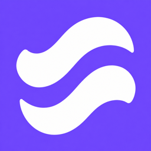
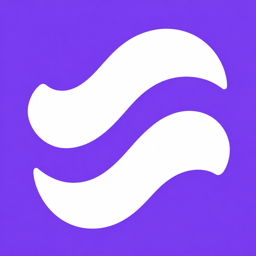
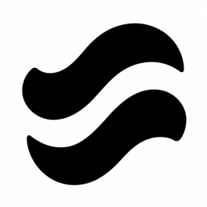

# Software Shaping: Flow identity

Sprint: **564** (`0f09b646-9acd-5bec-849d-2cf3b0e4edef`).
Story: **H6 / #3077** (`d73b75a590f0`).
This is a design decision and asset archive; it implements no application behavior.

## Selected mark

The user selected **B Flow**, the middle concept in the
[original comparison board](reference/selected-b-flow-board.png), after exploring
clover, rotated, overlapping and joined-center alternatives. Those later
alternatives do not replace the selected mark.

Flow consists of two separate, broad, flattened S-like curves in a compact
diagonal stack. The paired curves suggest **Software Shaping** without requiring
literal lettering. Preserve their separation, fluid silhouette and original
orientation. Do not add leaf details, join their centers, rotate them into a
cross, or substitute the later four-lobed designs. The design should remain
recognizable at small sizes and in one color.

The four-leaf clover was an early visual inspiration, not a fidelity requirement.
The selected direction prioritizes simplicity and a repeatable entry point
across participating apps.

## Screen and monochrome treatments

| Recommended screen treatment | Warmer alternate | Monochrome on white |
| --- | --- | --- |
|  |  |  |

- **Recommended screen palette:** white mark on blue-violet, target `#6D4AFF`.
- **Alternate screen palette:** white mark on warmer purple, target `#7C3AED`.
- **Monochrome:** black on white for print, documents and neutral presentation.

The user explicitly selected the B Flow shape and requested a violet/purple
background. Blue-violet is the recommended default used for the delivered
favicon; the warmer purple remains an alternative rather than a separately
approved brand color. These image-generated colors approximate the targets;
the hex values are design specifications, not pixel measurements.

The first transparent black exports were reported as nearly invisible. The
retained versions use opaque backgrounds, so they do not disappear against a
dark viewer or browser. Screen icons have full square backgrounds; platform
masking should determine their final rounded or circular presentation.

## Badge and entry-point wording

| Context | Label | Intended meaning |
| --- | --- | --- |
| Capability badge | **Shapeable with Bashy** | The app supports the shaping workflow. |
| App toolbar or menu action | **Shape** | Open shaping for the current app. |
| Compact control accessible name | **Shape this app** | Same action when only the mark fits. |
| Running-version status | **Shaped version** | A customized version is active; separate from capability. |

The badge and action share the same symbol. Prefer a visible label; color alone
must not convey capability or state. For an experienced user, the intended
entry point opens the existing `/shape/<app>/` workspace with the app selected,
without a mandatory introduction. Preview, verification, approval, history and
restore remain within the shaping workflow. Upstream submission is a separate
action. These are design recommendations, not claims of implemented UI.

## Files and intended uses

All assets are saved beside this document. Filenames include pixel dimensions.

| Files | Sizes in pixels | Use |
| --- | --- | --- |
| `blue-violet/blue-violet-N.png` | 16, 24, 32, 48, 64, 128, 180, 192, 256, 512, 1024 | Default screen icons and logo previews |
| `warm-purple/warm-purple-N.png` | Same as blue-violet | Alternate palette |
| `monochrome/flow-N.png` | 16, 24, 32, 48, 64, 96, 128, 180, 192, 256, 384, 512, 1024 | Black-on-white raster exports |
| [favicon.ico](favicon.ico) | 32 × 32, one image | Default browser favicon, white on blue-violet |
| Palette-specific `*-favicon.ico`; `monochrome/favicon.ico` | 32 × 32, one image each | Alternate favicons |
| `master.png` in each palette directory | Original generated dimensions | Source of that palette's resized exports |
| [Selected concept board](reference/selected-b-flow-board.png) | Original generated dimensions | Provenance of the selected B Flow concept |
| [SHA256SUMS](SHA256SUMS) | — | Integrity inventory for all image assets |

Use 16/32/48 px for browser contexts, 24/32/48/64 px for small interface
presentation, 180 px for an Apple touch image, and 192/512 px for web app image
inputs. The 256/512/1024 px files are larger logo assets. The supplied ICO is
single-resolution; it is not a multi-image 16/32/48 ICO container.

### Limits of this delivery

These are PNG/ICO raster assets, not an SVG master, native platform icon
package, layered Apple icon, or verified Android/PWA maskable asset. No app
manifest, browser metadata, source code or installed app was changed. Test
platform masks and small-size rendering during integration; these exports do
not establish that validation. For large print work, a future vector redraw
should preserve the selected silhouette.

Each palette is based on a generated redraw of the selected concept, so minor
geometry differences from the concept board are possible. All sizes within a
palette derive from its single preserved master, avoiding per-size redesign.

## Provenance and checks

The design was developed through user-directed visual exploration with the
built-in image-generation tool. The final instructions preserved the original
B Flow curves, removed all presentation text, requested a high-contrast opaque
background, and recolored the mark white for blue-violet and purple screen
treatments. Existing image conversion tools produced the dimensioned PNGs and
32 px ICOs. No drawing scripts or application implementation were added.

Acceptance checks for this documentation story are asset presence and relative
links, actual image formats/dimensions/opacity, checksum verification, and a
public-content review. Application and shell regression suites are not evidence
for this asset-only change and are not claimed as run.

## Reference guidance

- [MDN: favicon](https://developer.mozilla.org/en-US/docs/Glossary/Favicon) — browser icon purpose and common small size.
- [Apple: app icons](https://developer.apple.com/design/human-interface-guidelines/app-icons/) — simple backgrounds and system masking.
- [Apple: web app configuration](https://developer.apple.com/library/archive/documentation/AppleApplications/Reference/SafariWebContent/ConfiguringWebApplications/ConfiguringWebApplications.html) — touch-icon images.
- [Web app manifests](https://web.dev/articles/add-manifest) — 192/512 px web app icons.
- [Maskable icon safe zone](https://web.dev/articles/maskable-icon) — platform masking must be checked separately.
- [W3C: visible and accessible labels](https://www.w3.org/WAI/WCAG21/Techniques/general/G211.html) — preserve the visible action label in the accessible name.
